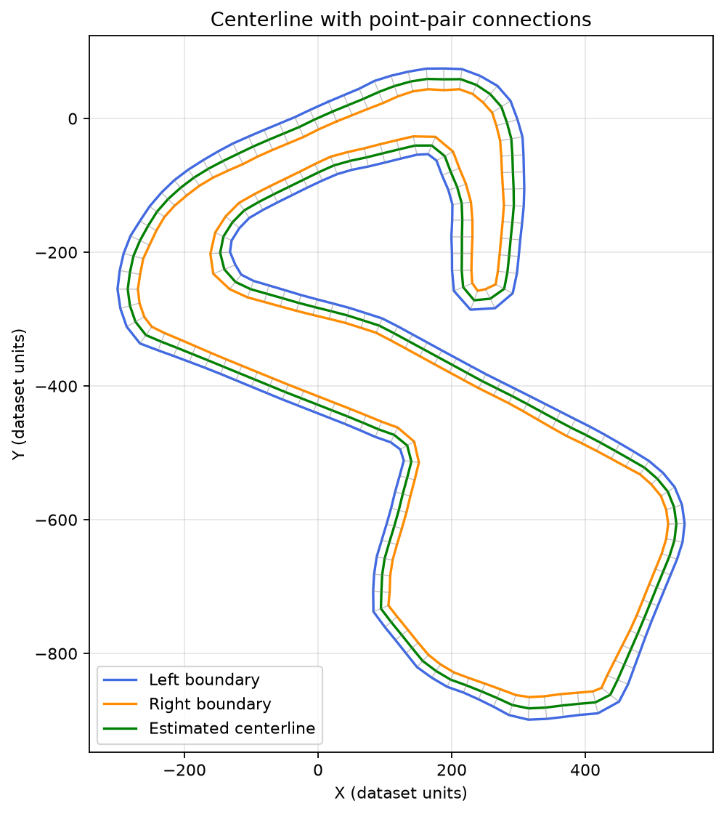

# Track Centerline with ROS 2 and Docker

A learning project based on the 2025 BGRacing Autonomous
Department home assignment.

The system reads track boundary points, sends them between
two ROS 2 nodes, and calculates an approximate centerline.
Each node runs in a separate Docker container.

## Result



## Pipeline

1. The publisher reads the CSV and skips invalid rows.
2. It publishes both boundaries on `/track_points` every 2 seconds.
3. The subscriber receives the message and validates the coordinates.
4. It calculates the midpoint of each corresponding boundary pair.
5. It saves a CSV and a PNG, once per subscriber run.

Messages use `std_msgs/msg/String` containing JSON with
`left` and `right` coordinate arrays.

## Dataset

Input: `BrandsHatchLayout.csv`

Columns: `x`, `y`, `side`.

Observed statistics:
- 314 data rows, excluding the header.
- 2 invalid rows skipped: file lines 2 and 159.
- 156 valid left-boundary points.
- 156 valid right-boundary points.
- 156 calculated centerline points.
- Boundary-pair distance: min 22.81, mean 27.57, max 35.68.

Coordinate units are not confirmed. Pair distances are not
necessarily perpendicular road widths.

The source dataset is not redistributed in this repository.

Download it from the assignment's dataset link:
https://drive.google.com/file/d/1aTa8a-nf8reb2oNBdP3yha32BTxCO5T7/view

Place it at:

```text
data/BrandsHatchLayout.csv
```

## Requirements

- Docker Engine and Docker Compose v2.
- Internet access for the first image build.
- The dataset downloaded separately.

The containers use Ubuntu 24.04, ROS 2 Jazzy and Python 3.12.
The project was run on Ubuntu ARM64 in a VirtualBox VM on a Mac.

## Run

From the repository root, after placing the dataset:

```bash
mkdir -p output/docker
sudo docker compose up --build
```

Wait for the subscriber to report that it saved the results.

Generated files:

```text
output/docker/centerline.csv
output/docker/centerline.png
```

To stop, press Ctrl+C, then run:

```bash
sudo docker compose down
```

Output files remain on the host. With the current configuration,
Docker may create them as root-owned files.

## Compare with the baseline

```bash
diff output/centerline.csv output/docker/centerline.csv
```

No output and an exit code of 0 mean the CSV files are identical.
This checks consistency with the baseline, not geometric accuracy.

## Code

| File | Role |
|---|---|
| `scripts/inspect_track.py` | Initial dataset inspection and point plot |
| `scripts/compute_centerline.py` | Initial local baseline |
| `scripts/track_core.py` | Reusable loading, midpoint and plotting functions |
| `scripts/track_publisher.py` | ROS 2 data publisher |
| `scripts/track_subscriber.py` | ROS 2 processing subscriber |
| `Dockerfile` | Container image definition |
| `compose.yaml` | Two-container configuration |
| `requirements.txt` | Python packages captured for the initial local prototype |

Docker installs its dependencies through apt; it does not use
the local prototype's requirements.txt.

## Algorithm and limitations

For each paired left and right point, the centerline point is:

```text
midpoint = ((left_x + right_x) / 2,
            (left_y + right_y) / 2)
```

The method assumes that both boundaries:
- Have equal valid point counts.
- Follow the same traversal direction.
- Are aligned so that equal indices describe corresponding locations.

Equal point counts alone do not prove correct correspondence.
Pair connections and the resulting path were inspected visually.

This baseline does not solve unordered point matching,
obstacle avoidance, vehicle control, or optimal racing-line planning.
Skipping missing rows can break correspondence on other datasets.

The subscriber processes only the first valid track per run.
It does not continuously update the path.

## Learning context

Developed with AI-assisted guidance as a hands-on learning project.
The work covers CSV validation, geometric processing, ROS 2
publisher/subscriber communication, Docker and Git.

This is an independent project, not an official BGRacing solution.
